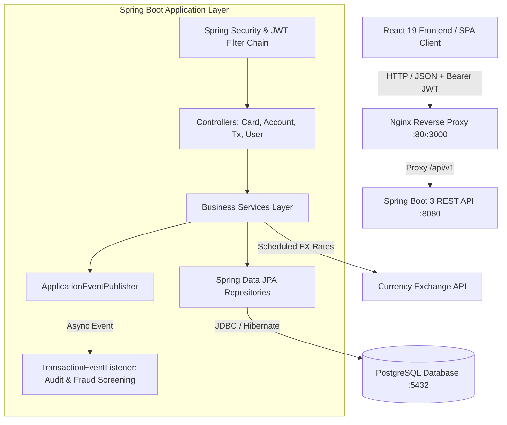

# Bankify - Modern Core Banking & Card Payment Platform

A production-ready full-stack banking platform built with **Java 21**, **Spring Boot 3**, **React 19**, and **PostgreSQL**. Designed with an event-driven architecture simulating payment network operations (card issuing, debit/credit processing, real-time ledger accounting, and FX conversions).

---

## 🏛️ System Architecture



---

## 🚀 Features & Mastercard Domain Alignment

| Domain Feature | Description | Architecture / Layer |
| :--- | :--- | :--- |
| **Card Management** | Virtual & physical card issuance, 16-digit card number generation, CVV generation, balance credit and debit operations. | [CardController](backend/src/main/java/slbank/web/app/Controller/CardController.java) & [CardService](backend/src/main/java/slbank/web/app/service/CardService.java) |
| **Transaction Processing** | Double-entry ledger simulation: deposits, withdrawals, transfers, fee calculation, and transaction history pagination. | [TransactionService](backend/src/main/java/slbank/web/app/service/TransactionService.java) |
| **Event-Driven Architecture** | Asynchronous domain events fired upon transaction completion to simulate audit logs and risk/fraud screening heuristics. | [TransactionCreatedEvent](backend/src/main/java/slbank/web/app/event/TransactionCreatedEvent.java) & [TransactionEventListener](backend/src/main/java/slbank/web/app/event/TransactionEventListener.java) |
| **Foreign Exchange (FX)** | Multi-currency accounts with scheduled background task execution polling real-time currency conversion rates. | [ExchangeRateScheduleTaskRunnerComponent](backend/src/main/java/slbank/web/app/service/ExchangeRateScheduleTaskRunnerComponent.java) |
| **Stateless Security** | Spring Security 6 filter chain with BCrypt password hashing and JWT token authorization. | [SecurityConfig](backend/src/main/java/slbank/web/app/config/SecurityConfig.java) & [JwtAuthenticationFilter](backend/src/main/java/slbank/web/app/filters/JwtAuthenticationFilter.java) |
| **Interactive API Docs** | OpenAPI 3.0 / Swagger UI with Bearer Authentication support. | [OpenApiConfig](backend/src/main/java/slbank/web/app/config/OpenApiConfig.java) |

---

## 🛠️ Technology Stack

- **Backend**: Java 21, Spring Boot 3.5.5, Spring Data JPA, Spring Security, JWT (io.jsonwebtoken 0.12.5), SpringDoc OpenAPI (v2.8.5).
- **Frontend**: React 19, Vite 7, Redux Toolkit, React Router v7, Tailwind CSS v4, Axios.
- **Persistence**: PostgreSQL (Production/Docker), H2 (In-memory Test Suite).
- **DevOps & Containers**: Docker, Docker Compose, Multi-stage builds, Nginx reverse proxy.
- **CI/CD**: GitHub Actions workflow running automated unit tests, linting, packaging, and Docker build checks.

---

## ⚡ Quick Start with Docker (Recommended)

Run the entire full-stack application (PostgreSQL + Spring Boot Backend + React Frontend) with a single command:

```bash
docker compose up --build
```

- **Frontend App**: [http://localhost:3000](http://localhost:3000)
- **Backend API**: [http://localhost:8080/api/v1](http://localhost:8080/api/v1)
- **Swagger UI**: [http://localhost:8080/api/v1/swagger-ui.html](http://localhost:8080/api/v1/swagger-ui.html)
- **PostgreSQL**: `localhost:5432` (Database: `bankify`, User: `postgres`, Password: `root`)

To stop:
```bash
docker compose down -v
```

---

## 💻 Local Development Setup

### Prerequisites
- Java 21+ & Maven 3.8+
- Node.js 18+ & npm
- PostgreSQL running locally or in Docker

### 1. Database Setup
```bash
createdb bankify
```

### 2. Backend Setup
```bash
cd backend
./mvnw spring-boot:run
```
Backend runs at `http://localhost:8080/api/v1`.

### 3. Frontend Setup
```bash
cd frontend
npm install
npm run dev
```
Frontend runs at `http://localhost:5173`.

---

## 🧪 Testing & Quality Gates

Run backend unit and integration tests (uses isolated in-memory H2 database):

```bash
cd backend
./mvnw test
```

Test suite includes:
- [CardServiceTest](backend/src/test/java/slbank/web/app/service/CardServiceTest.java): Card issuance validation, minimum deposit limits, card credit and debit logic.
- [TransactionServiceTest](backend/src/test/java/slbank/web/app/service/TransactionServiceTest.java): Ledger entry creation, pagination, and domain event dispatching.
- [AccountServiceTest](backend/src/test/java/slbank/web/app/service/AccountServiceTest.java): Inter-account fund transfers and exchange rate operations.

---

## 🔄 CI/CD Pipeline

Automated through GitHub Actions in [.github/workflows/ci.yml](.github/workflows/ci.yml):
1. **Backend CI**: Sets up JDK 21, runs tests (`mvn clean test`), builds release jar.
2. **Frontend CI**: Sets up Node.js 20, verifies linting, builds production bundle.
3. **Container Build Verification**: Builds multi-stage Docker images to guarantee deployment readiness.
